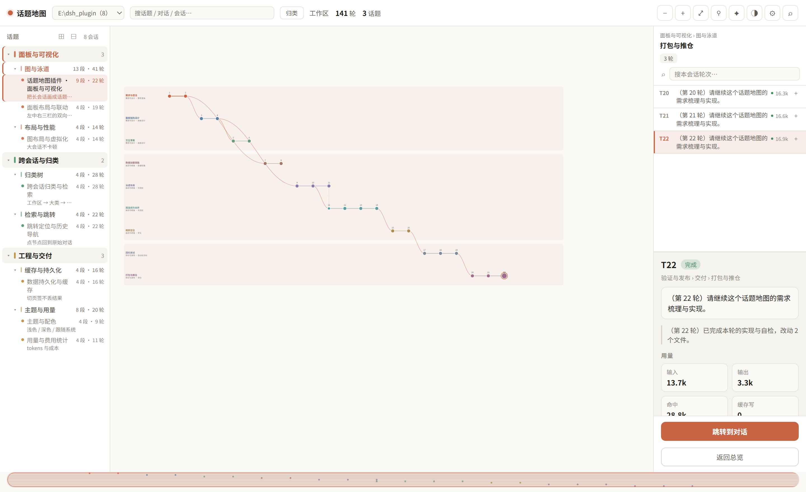

# dsh-topic-map

把一个工作区里的**所有会话**看成一张可导航的地图：左边是「哪些事」，中间是「这件事有哪些对话/会话」，
右边是「这一轮具体做了什么」。

两件事共用同一份轮次模型：**横看是时间，纵看是话题**。



> 截图来自真实 `lib/client.js` 的独立渲染（合成数据，不含任何本机会话内容）。

---

## 它解决什么

| 问题 | 回答方式 |
|---|---|
| 这个工作区里一共有哪些事？ | 左栏「话题 → 对话 → 会话」三级树（顶栏选工作区，默认跟随当前会话所在工区） |
| 当前这条会话属于哪个话题、哪个对话？ | 左栏**默认高亮**当前会话的归属；右栏顶部显示 `话题 › 对话` |
| 这一条对话有多大？ | 每个「对话」显示 `N 段 · M 轮`（段=话题段，轮=用户输入次数） |
| 某段会话到底在做什么？ | 每个会话下面一行是提炼出的一句话主题——标题常是"继续""开始吧"，主题才看得出内容 |
| 这一轮是哪一轮？在哪？ | 图上悬停看摘要；点节点 → 右栏定位到该轮；`跳转到对话`回到原始对话 |
| 想找"以前在哪说过这个"？ | 顶栏一个框搜两种：结构（话题/对话/会话名）+ 正文（对话内容），正文命中单独列组 |
| 这段会话里话题是怎么走的？ | 泳道图：一条泳道一个话题段，节点是轮次，虚线/弧线表示断裂、分支、汇合 |
| 哪几个会话在讲同一件事？ | 归类把它们放进同一个「话题 › 对话」下 |

---

## 界面

```
┌──────────────────────────────────────────────────────────────────────────────────┐
│ ● 话题地图  [工作区 ▾]  [搜话题 / 对话 / 会话…]  [归类]  工作区 32·轮 335  −+⤢⚲✦◑⚙⌕ │
├────────────────────────────┬──────────────────────────────────┬──────────────────┤
│ ● 正文命中 2               │  话题 › 对话              [返回] │ 轮次列表   [搜本会话]│
│  · 开始吧       72 轮      │  ──────────────────────────────  │  T73  已完成      │
│  · 继续         12 轮      │  ● 会话1  12段·72轮              │  插件开发 › 话题地图│
│ ★ 插件开发            8    │  ● 会话2   4段·21轮              │  输入/输出/耗时    │
│   ★ 话题地图     13段·74轮 │  ● 会话3   7段·9轮               │  ── 详情 ──       │
│       ▸ 会话历史…  13段·74轮│                                  │  [跳转到对话]      │
│     ▸ 开关机动画   7段·21轮│                                  │  [返回总览]        │
│ ▸ 环境与排障          5    │                                  │                  │
│ ⊞ 全部展开  ⊟ 全部折叠     │                                  │                  │
├────────────────────────────┴──────────────────────────────────┴──────────────────┤
│ 缩略条 ▓▓▓▓▓▓▓▓░░░░░░░░░░░░░░░░░░░░░░░░░░░░░░░░░░░░░░░░░░░░░░░░░░░░░░░░░░░░░░░░ │
└──────────────────────────────────────────────────────────────────────────────────┘
```

### 顶栏

| 控件 | 作用 |
|---|---|
| 工作区下拉 | 切换工作区；默认是当前会话所在工区。括号里是该工区的会话数 |
| 搜索框 | **一个框两用**：即时筛左栏结构（话题/对话/会话名），防抖 500ms 后跨会话搜**对话正文** |
| `归类` | 让模型把工作区会话归成话题树（有缓存；运行中变「归类中…」） |
| KPI | 工作区会话数 / 总轮数 |
| `−` `+` | 缩放（滚轮亦可，锚点在鼠标位置） |
| `⤢` | 复位到全览（双击空白 / Esc 同样生效） |
| `⚲` | 清除泳道聚焦 |
| `✦` | 用模型精化分段（2 步，先预览后确认；运行中可取消） |
| `◑` `◐` | 主题：跟随系统 / 浅色 / 深色 |
| `⚙` | 设置：模型、轮次上限、自定义端点 |
| `⌕` | 诊断：检查对话 DOM 与跳转过程 |

### 左栏：三级导航树

`话题 → 对话 → 会话`，三级都可折叠。两种"亮"要分清：

| 标记 | 含义 | 视觉 |
|---|---|---|
| **归属高亮**（`data-owner`） | 当前会话**属于**这里 | 左侧竖条，**默认就亮** |
| **浏览高亮**（`data-scope`） | 你**正在看**这一层 | 整行底色，点击后才有 |

顶部还有两个特殊组：

- **正文命中**：搜正文时出现，显示会话标题 + 命中片段 + 轮数
- **未归类**：新建但还没归类的会话，带 `归类` 按钮（0 轮的空会话不列出）

### 中间：列表或地图

点左栏条目逐级下钻：**话题 → 对话列表 → 会话列表 → 地图**，面包屑可逐级返回。
地图上横轴是轮次、一个节点一轮、一条泳道一个话题段。

### 右栏：轮次列表 + 详情

- 搜索框只搜**当前会话**的提问与回复，显示匹配数
- 顶部显示该轮的归属路径 `话题 › 对话`（不是"未分类"）
- 选中某轮看完整信息：模型、输入/输出 token、耗时、步数、工具调用、涉及文件
- 底部两个动作：`跳转到对话` / `返回总览`
  - 跳转不可用时按钮**置灰并直接写出原因**（例如"当前正在查看另一个会话"），不会静默消失

---

## 四级导航

```
工作区 ──▶ 话题 ──▶ 对话 ──▶ 会话 ──▶ 地图
          (模型归类)  (模型归类)  (平台会话)  (泳道)
```

点「话题」→ 中间列出它下面的**对话**；点「对话」→ 列出**会话**；点「会话」→ 画出泳道图。
左栏、中间、右栏三处**双向联动**：在任一处理解层次，另外两处跟着动。

---

## 对象层级

```
工作区   E:\dsh_plugin（会话集合的边界，不跨工作区）
 └ 话题  「插件开发」            3-6 个，模型划分
    └ 对话「话题地图」            每个话题 2-4 个
       └ 会话「会话历史话题树插件调研」  一句话主题 + 段数 + 轮数
          └ 话题段（泳道）       每会话 1..N 条
             └ 轮次            一次用户输入
```

上三层（工作区/话题/对话）回答"这个工作区在推进什么"，
下两层（话题段/轮次）回答"这一次会话内部怎么走的"。
**两者独立建模**：看图不依赖归类树，归类失败也不影响泳道图。

---

## 图上的元素

| 元素 | 视觉 | 含义 |
|---|---|---|
| **lane** | 实线 | 同一话题段内的相邻轮次 |
| **lane（gap）** | 虚线 | 这条线中途断过又接上（回游） |
| **fork** | 斜向曲线 | 从父线某轮分出支线 |
| **merge** | 反斜曲线 + 圆环 | 两条线汇成一条（此后不再分开） |
| **share** | 短竖线 | 同一轮同属两个话题 |
| **related** | 贯穿淡虚线 | 两条话题线内容相似（纯本地计算，零 token） |

**主线**（第一个话题段）线宽更粗、不透明度更高；**支线**更细。
聚焦某条泳道时，其它泳道整体变淡。

---

## 数据从哪来

Host 半只提供 `/api/topic-map/*` 的一组端点。面板**不碰你的对话，只读日志**。

| 端点 | 作用 |
|---|---|
| `GET  /health` | 磁盘引擎版本 vs 运行中版本（**所有端点统一 `{ ok, value }` 信封**） |
| `POST /session` | 单会话：轮次、泳道、拓扑、费用 |
| `POST /workspaces` | 工作区清单（含会话数） |
| `POST /sessions` | 某工作区的会话清单 |
| `POST /categorize` | 工作区归类树（带缓存，可 `force`） |
| `POST /overview` | 工作区概览 |
| `POST /find` | 跨会话正文检索 |
| `POST /analyze` | 精化分段（2 步，产出待确认预览） |
| `POST /progress` `POST /cancel-analyze` | 进度轮询 / 取消 |
| `POST /apply-semantic` `POST /revert-semantic` | 采纳 / 回退精化结果 |
| `POST /ui-state` | 界面状态读写（筛选、选中项等） |
| `GET/POST /config` | 模型与轮次上限 |
| `POST /reload` | 重载 Host 半（ESM 缓存） |

读的是宿主公开契约：`ctx.sessionQuery.readSession` / `readTitleSnapshots` / `listEvents`、
`ctx.sessionPersistence.stat`、`ctx.get('workspaceRegistry')`。

---

## 分段（会话内部的话题段）

**两层：本地规则先切，模型只改有把握的边界。**

### 本地（零成本，永远可用）
`lane-engine.js`：TF-IDF 余弦相似度，阈值 0.2，最小段长 2 轮，
过短的段并入相邻段；中途回游超过 0.55 相似度则接回原段。

### 模型精化（点 `✦` 才发生）
2 步：**分段**（边界判定）→ **合并**（把被打断后回来的同一件事并回去）。

合并这一步必须存在，因为分段按"相邻轮次是否同一件事"做，
同一件事被打断再回来会被切成两条线。判据交给模型，因为纯字面相似度系统性失效：

```
「跳转定位」 vs 「落点偏差」   字面几乎不重合  → 却是同一件事的两个阶段
「面板空白」 vs 「面板配色」   字面高度重合    → 却是两件不同的事
```

工程上的克制：先挑候选对（字符重合 + 时间邻近），最多问 14 对，不是 n²。
**先预览后确认**，不点采纳就不改图。

---

## 跨会话归类怎么来的

工作区里有几十个会话、标题常是"继续""开始吧"，直接丢给模型归不准。所以分三段：

1. **提炼主题**（`session-digest.js`）—— 每个会话抽样若干轮，压成一句话主题 + 关键词。
   长会话才抽样；短会话直接用标题。**这是让"继续"变成"面板布局与联动"的那一步。**
2. **分批归类**（`session-category.js`）—— 每批独立调一次模型，
   输出 `{"category":"话题名","sub":"对话名"}`。严格校验长度，错位就整批作废。
3. **合并批结果 + 重命名** —— 多批会出现同义不同名（"插件开发"/"插件研发"），
   再调一次模型做名称归并，然后按名字合并分组。

约束：建议 3-6 个话题、每个话题最多 4 个对话；单次最多 200 个会话参与归类（超出截断），
工作区会话数超过 1000 时直接拒绝，提示先筛选。

**缓存判定是"缓存里的会话现在都还在"，不是"集合完全相等"。**
否则每新建一个空会话就全量重算——实测每次打开面板要等 25-30 秒。

**新会话不再让缓存失效**：新增的会话一律先进「未归类」组，只有用户点「归类」才调模型。
早先容错值是 3，一次新建四五个会话（开几个方向并行试，很常见）就会让缓存失效，
下次打开面板突然等 30-40 秒——用户并没有要求此时归类。

**模型全部批次失败时不会落盘**：否则降级结果（所有会话塞进"未归类"）会被当成有效缓存
一直复用，等于模型临时不可用就把分类永久降级了。

---

## 检索

一个输入框，两种检索，结果分两组呈现：

| 位置 | 范围 | 命中后 |
|---|---|---|
| 顶栏（即时） | 话题/对话/会话**标题** | 左栏高亮并自动展开，中间自动打开第一个匹配 |
| 顶栏（防抖 500ms） | 工作区内**全部会话正文** | 左栏顶部「正文命中」组，带命中片段 + 轮数 |
| 右栏 | **当前会话**的提问与回复 | 轮次列表过滤，显示匹配数 |

正文检索在 Host 侧完成：读各会话日志、匹配提问与回复、只回传片段与轮次号。
带 60 秒进程内缓存（按会话存轮次摘要），实测首次约 10 秒、之后约 1.5 秒。

> 为什么必须单独一组：标题叫「开始吧」「继续」的会话，靠结构搜索永远找不到；
> 正文命中能搜出来，并用片段说明"为什么它被搜到"。

---

## 实时性

面板会在切换页签时卸载重建，所以"新内容能不能自己出现"是必须专门处理的：

| 场景 | 机制 | 延迟 |
|---|---|---|
| 当前会话**新写了一轮** | 订阅宿主 `binding(id).eventSource` 的 `revision`，防抖 1.2 秒后刷新 | 1-2 秒 |
| 工作区**新开了一个会话** | 每 15 秒轻量读 `/workspaces`，比对 `sessionIds` 签名，变了才重载树 | ≤15 秒 |
| 窗口重新获得焦点 | `focus` / `visibilitychange` 触发 | 即时 |
| 切页签回来 | 读前端快照立即渲染，再后台校准 | 即时 |

轮询三个约束：页面不可见不轮询、上一轮没返回不叠加、正在归类不打扰。

---

## 缓存

三层，各自解决不同问题：

| 层 | 内容 | 失效条件 |
|---|---|---|
| **前端会话快照** | 单会话 payload（内存，TTL 5 分钟） | 切页签回来直接用，随后静默刷新 |
| **前端归类树** | 工作区树（内存，TTL 60 秒） | 命中时**不再先清空树**，避免左栏闪一下 |
| **Host 会话缓存** | 按 `(sessionId, revision, ENGINE_VERSION)` | revision 变或引擎版本变 |
| **归类树缓存** | 落盘 `workspace-category-<id>.json` | 缓存里的会话消失了 |
| **轮数缓存** | `sessionId → { revision, turns }` | 按 revision 增量判断 |

### 轮数为什么能全量刷新

早先全量刷新 32 个会话要 **3877ms**（每个会话都读一遍事件流），所以只敢刷当前会话——
代价是左栏其它会话的数字长期是旧值。

现在按 `revision` 做增量判断：没变的会话**一次事件流都不读**，只花一次 `stat`。

```
改前全量刷新   3877 ms
改后全量刷新     98 ms      ← 30 倍
冷启动第 1 次   467 ms      （只算当前会话，其余后台预热）
```

所以前端现在**始终请求全量刷新**，左栏每个会话的数字都跟着实际历史走。

---

## 性能设计

会话越用越长（实测单会话已到 78 轮），几条关键措施：

| 措施 | 做法 |
|---|---|
| **视口虚拟化** | 节点数 > 60 时只渲染可见区域（外扩半屏）内的节点。缩放到全览时全部可见，等于不虚拟化——所见即所渲染 |
| **编号降级** | 节点数 > 100 时只给选中/悬停/聚焦泳道的节点画轮次编号 |
| **拖拽节流** | `pointermove` 只累计位移，每帧最多提交一次 `setView` |
| **悬停节流** | 提示框位置用 rAF 合并，位移 < 3px 不更新 |
| **邻接计算** | 从"每个节点重扫整张图"（O(n²)）改为预计算集合，循环内 O(1) 查表 |
| **分段窗口** | 默认只把最近 50 轮交给模型，更早的沿用本地规则 |
| **无后台遥测** | 不跑任何"定时测量 DOM"的逻辑 |

实测（合成 200 节点 / 820×480 视口）：不虚拟化约 400 个 SVG 元素，虚拟化后 115 个。

---

## 模型配置与成本

默认**跟随当前会话模型**，零配置可用：从该会话最近一条 `request/header` 取
`provider / model`。工作区归类时按会话顺序试前 8 个，取第一个能解析出来的。

也可填自定义端点（OpenAI 兼容）：`base_url` / `api_key` / `model_name`。
自定义端点优先；失败自动回退会话模型，并在预览条标注「已回退」。

> ⚠️ `api_key` **明文**存在 `~/.dsh/topic-map/config.json`。

| 动作 | 调用次数 | 何时 |
|---|---|---|
| `✦` 精化分段 | 2 步（分段 + 合并） | 手动点击 |
| `归类` | 按会话量分次（主题提炼 + 分批归类 + 可能的重命名） | 手动点击 |
| 日常浏览 | **0 次** | — |

**默认不调用模型。你不点，就不花 token。**

### 带推理的模型要注意

这类辅助任务（打标签、归类）不需要长思考，而带推理的模型会把输出预算大量花在思考上，
常见结果是"推理说完、正文一个字没有"。所以：

- 优先请求最低推理强度（模型不支持则退回）
- 输出上限放到 32768
- 空正文时显式报错并带上 `finish` 原因、推理字数、`maxTokens`，方便定位

---

## 数据存放

| 内容 | 位置 |
|---|---|
| 模型配置 | `~/.dsh/topic-map/config.json` |
| 精化分段结果 | `~/.dsh/topic-map/segments/<sessionId>.json` |
| 工作区归类树 | `~/.dsh/topic-map/ui/workspace-category-<workspaceId>.json` |
| 界面状态（筛选、选中项） | `~/.dsh/topic-map/ui/<sessionId>.json` |
| 折叠 / 主题 / 缩放 | 浏览器 sessionStorage（按会话分开） |

删掉 `workspace-category-*.json` = 下次打开重新归类。
删掉 `ui/<sessionId>.json` = 清除该会话的界面状态。

### 缓存会自己瘦下来

`ui/` 与 `segments/` 里的文件是"每工作区一份、每会话一份"，**只增不减**。
所以启动时会做一次清理：超过 **90 天**没被用过的文件自动删除。

判据是**最后使用时间**，不是最后写入时间——每次读到缓存都会刷新它的 mtime
（每个文件每个进程只刷新一次，不增加额外写盘）。否则"内容早已稳定、
但一直在被读"的缓存会被误当成冷数据删掉，而重建它要重跑模型，最贵。

清理的边界：只扫 `topic-map/ui` 与 `topic-map/segments`，只认文件名带 `.json`
的，按 mtime 判断，`config.json` 在上级目录不受影响，任何异常都忽略。

---

## 架构

```
lib/                                30 个模块
├── index.js            Host 半：路由、配置、模型编排、检索、归类
├── client.js           Client 半：面板 UI（单文件 bundle，内嵌纯函数模块）
│
├── 单会话
│  ├── turn-model.js    事件日志 → 每轮事实
│  ├── lane-engine.js   词面相似度分段（本地规则）+ 引擎版本
│  ├── semantic.js      模型分段：提示词 + 严格解析
│  ├── topic-merge.js   模型判断"是否同一件事"
│  ├── topic-graph.js   关系推导：主线/分支/合并/共享/相关
│  ├── graph-layout.js  拓扑 → 可绘制几何
│  └── payload.js       纯函数组装（Node 里可跑，无需 Harness）
│
├── 跨会话
│  ├── session-digest.js   会话 → 一句话主题
│  ├── session-category.js 分批判类 + 合并 + 重命名 + 缓存判定
│  └── （find 跨会话正文检索在 index.js）
│
├── 视图与交互
│  ├── viewport.js      缩放平移数学
│  ├── theme.js         两套主题 + 话题色板
│  ├── filter.js        搜索与多条件筛选
│  ├── tree-fold.js     折叠与路径推导
│  ├── progress.js      分析分步进度
│  └── ui-state.js      界面状态归一化与合并
│
└── 基础设施
   ├── cost.js prices.js  费用估算
   ├── session-cache.js   按 revision 的 LRU 缓存
   ├── llm-call.js        走宿主 llm 服务
   ├── remote-llm.js      走自定义 OpenAI 兼容端点
   ├── model-output.js    模型输出的宽松解析
   ├── classification.js  旧分类与新轮次协调
   └── pm-model.js status-review.js deliverables.js report.js
                          状态/复核/交付物/导出 —— 数据层保留，界面未接线
```

### 两条设计约束

**① 纯逻辑与 I/O 分离。** `payload.js` 及其下游全部是纯函数，可以在 Node 里直接跑测试，
不需要启动 Harness。Host 半只负责读事件、调模型、写文件。

**② 浏览器 bundle 内嵌纯函数。** `client.js` 是单文件，不能 `import`。
`scripts/build-theme.mjs` 把纯函数模块的源码**原样嵌入**，保证浏览器里跑的就是测试过的那份。

> 这个机制有个坑：导出清单是手写的，漏一个函数运行时就是 `TypeError` + 白屏，
> 而单元测试全绿（它们测 `lib/` 源码，不是 bundle）。
> 因此有 `scripts/verify-bundle.mjs` 与 `tests/bundle.mjs` 做符号完整性校验。

---

## 开发

```bash
node scripts/test-all.mjs       # 全部测试（同时看退出码与 FAIL 行数）

node scripts/build-theme.mjs    # 改完纯函数模块后重新生成 bundle
node scripts/build-viewport.mjs
node scripts/verify-bundle.mjs  # 必做：检查导出完整性
```

**改了 `lib/index.js`（Host 半）需要重启 DSH 或调 reload 端点**——ESM 模块在进程内会被缓存。

```bash
curl -X POST http://127.0.0.1:<当前端口>/api/topic-map/reload \
     -H "content-type: application/json" -d '{}'
```

返回 `reloaded: false` 说明有模块导入失败，需要重启 DSH。

### 测试

**38 个文件、742 项断言，全部通过。** 数字随迭代增长，以 `node scripts/test-all.mjs`
的实际输出为准。

| 文件 | 项数 | 覆盖 |
|---|---|---|
| `session-category.mjs` | 47 | 分批判类、合并、重命名、缓存判定 |
| `check.mjs` | 43 | 折叠、分段、计费、缓存 |
| `report.mjs` / `topic-graph.mjs` | 34 | 交付物·风险·导出 / 主线·分支·合并·共享 |
| `pm.mjs` | 31 | 状态与依赖推导 |
| `sidebar.mjs` | 30 | 左栏层级与计数 |
| `filter.mjs` | 29 | 搜索与多条件筛选 |
| `semantic.mjs` | 27 | 模型分段解析 |
| `hierarchy.mjs` / `session-digest.mjs` | 26 | 分层归并 / 主题提炼 |
| `theme.mjs` | 25 | 主题 + 布局锁定 |
| `ui-state.mjs` | 23 | 界面状态持久化 |
| `jump.mjs` / `remote-llm.mjs` / `topic-merge.mjs` | 22 | 跳转落点 / 自定义端点 / 合并判断 |
| `graph-mode.mjs` / `model-output.mjs` / `status-review.mjs` | 21 | 着色 / 输出解析 / 复核 |
| `perf-jump.mjs` | 21 | 跳转精度 + 渲染性能 + 前端缓存 |
| `portability.mjs` / `tree-fold.mjs` / `viewport.mjs` | 20 | 可移植性 / 折叠 / 缩放平移 |
| `progress.mjs` | 19 | 分析进度 |
| `graph.mjs` / `layout.mjs` | 17 | 拓扑与 merge 边 / 内容坐标 |
| `bundle.mjs` | 16 | **导出完整性（防白屏）** |
| `focus.mjs` / `regress-ux.mjs` / `linkage.mjs` | 13 | 聚焦联动 / 缩进回归 / 左中右双向联动 |
| `payload.mjs` | 11 | 端到端字段 |
| `pin.mjs` | 10 | 落点贴顶（含宿主回弹） |
| `freshness.mjs` / `jump-flow.mjs` | 7 | 新增轮次归属 / 跳转流程 |
| `live-update.mjs` | 5 | 实时更新（事件源 + 轮询） |
| `remount-cache.mjs` / `jump-session-scope.mjs` / `workspace-selection.mjs` | 3 / 3 / 2 | 重挂载缓存 / 会话作用域 / 工作区切换 |
| `smoke.mjs` | 1 | 200 轮规模自检 |

---

## 已知局限

**① 跨会话跳转做不到。** 平台只暴露 `openView(view, focus)`——能切视图，不能切会话。
所以"跳转到对话"只对**当前平台会话**有效；查看其它会话时按钮置灰并说明原因。

**② 跳转依赖宿主 DOM。** 定位靠 `[data-chat-turn]` 与历史导航服务，宿主改结构就会失效。
已尽力加固：不要求原生导航按钮可点、找不到行时先按比例粗定位一次、重试预算约 8 秒、
识别宿主"回弹到底部"并继续纠正。

**③ 空会话不显示。** 新建但还没说话的会话（0 轮）不进「未归类」，等它有第 1 轮后才出现。

**④ 归类是字符串，不是实体。** 话题/对话名是模型生成的自由文本，没有稳定 ID，
改名即断链，跨会话聚合靠名字相等。

**⑤ 正文检索要读日志。** 首次约 10 秒（33 个会话），之后 1.5 秒。缓存按会话 TTL 60 秒。

**⑥ 状态与导出未接线。** `pm-model.js` / `status-review.js` / `deliverables.js` / `report.js`
的数据层完整且被测试覆盖，但界面没有入口——所以当前版本**不显示任务状态胶囊、不提供导出**。

**⑦ 相关性只在同一次会话内。** `findRelated` 比对的是同一会话的话题线，
跨会话的内容相似度没有聚合。

**⑧ 没有真实会话血缘。** 图上的 fork/merge 是**话题关系**，不是宿主记录的父子会话。
宿主有 `ctx.sessions.fork({ sessionId, atSeq })` 与 `sessionQuery.traceSession()`，
本插件还没有接入——"从某一轮开新对话"目前只能去 DSH 自己的界面点。

**⑨ 没有时间维度。** 只有时序图，没有工期/甘特。`durationMs` 是对话耗时，不等于工作实际用时。

---

## License

MIT
